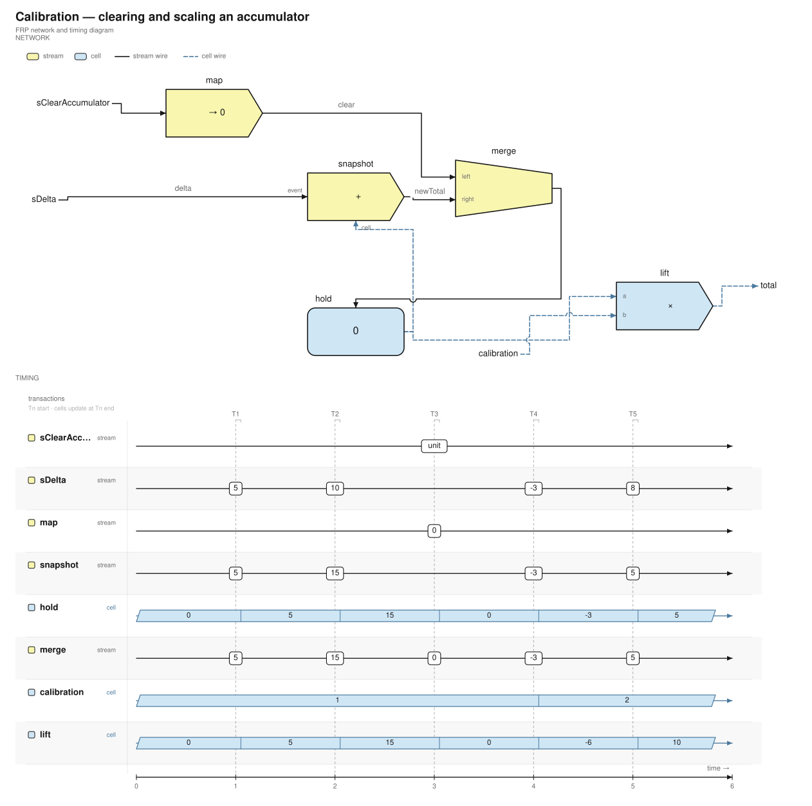
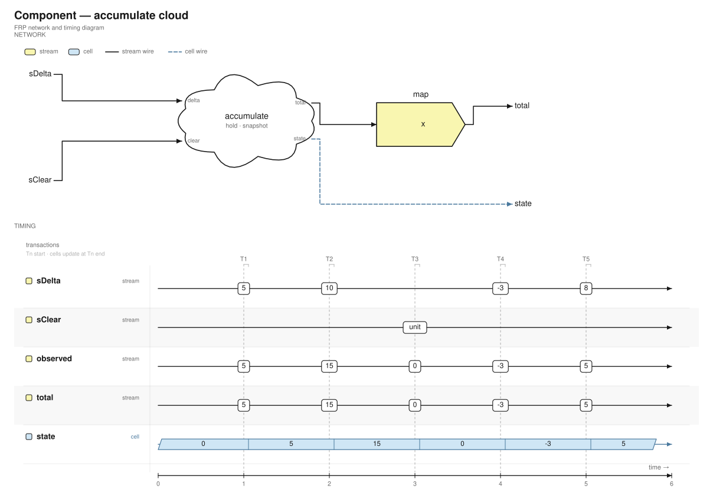
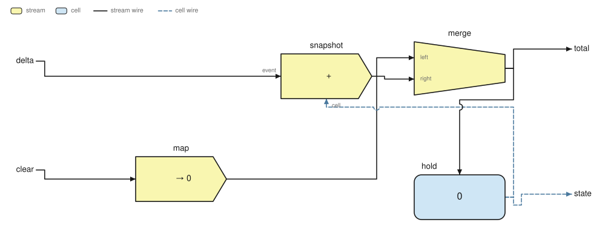
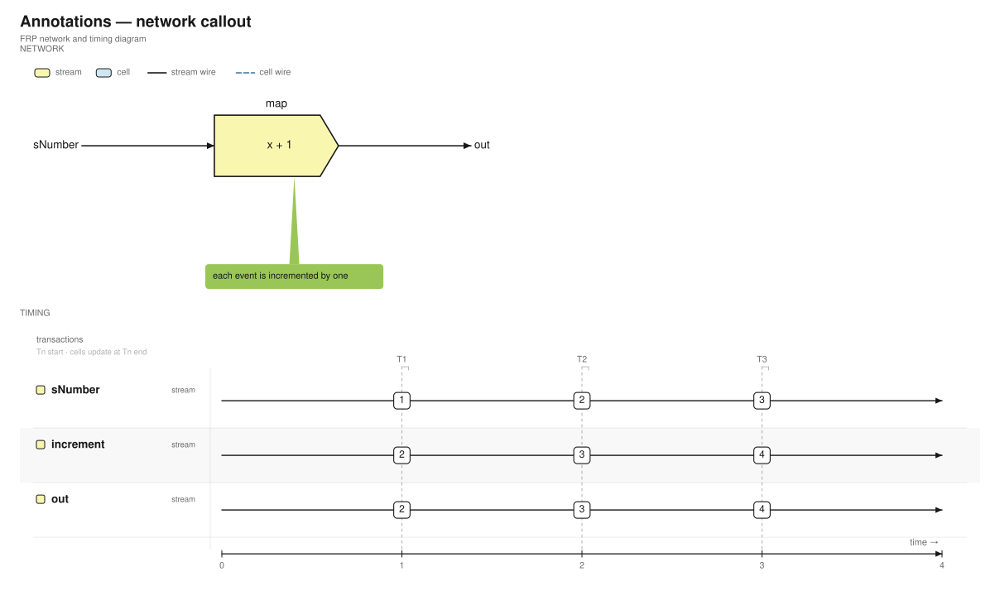
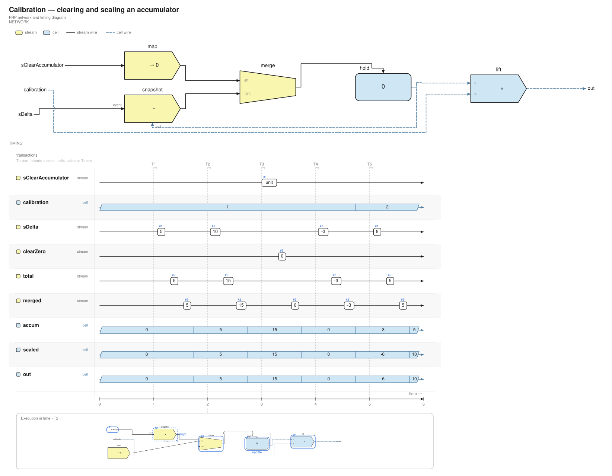
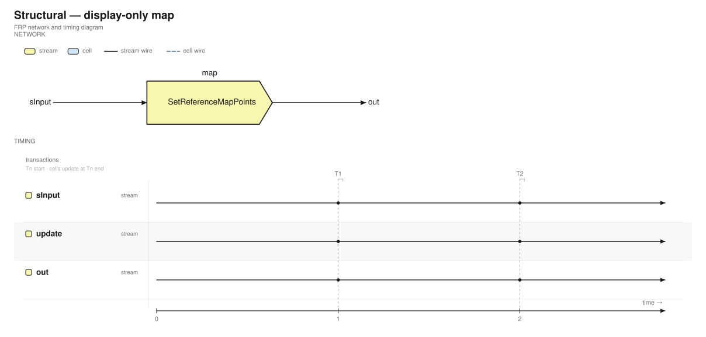

# frp-visualizer

[](https://github.com/39sho/frp-visualizer/actions/workflows/ci.yml)
[](LICENSE)

FRP（Functional Reactive Programming）の **Stream / Cell ネットワークを JSON で定義し、離散トランザクションでシミュレーションして SVG に出力する CLI ツール**です。ネットワーク図とタイミング図を同時に生成します。



## Features

- `map` / `filter` / `merge` / `snapshot` / `hold` / `lift` などの FRP プリミティブ
- Stream と Cell の型付きポート、離散トランザクションによるシミュレーション
- `network.svg` / `timing.svg` / `diagram.svg` / `diagram.json` の出力
- **orthogonal 配線**（デフォルト）と `--route hybrid` の斜め配線
- モジュールを避けるルーティング、平行線の分離、交差部のホップ
- Cell を帯で示すタイミング図、トランザクション開始／終了ティック
- **Component 雲**（入出力ポート・多出力・内部ネットワークの展開表示・内部状態を含むシミュレーション）
- Sink / Component 出力の lane 化と、Component 内部スコープの timing 生成
- 値を出さない **event-only timing**（`--timing-values none`）
- focus した Transaction の **active サブグラフを timing 内に表示**
- `trace.json`（Transaction / lane / event / value / timing reliability）
- `check --strict` と render 時の検証による欠落入力・不正接続の検出
- Node / Edge / Transaction に紐づく**注釈吹き出し**
- Mermaid 風の**テキスト DSL** から JSON への一方向コンパイル
- 構造スケッチ用の **structural mode** と表示専用 `display` ラベル
- `--focus-transaction N` による実行フォーカスパネル
- 手動レイアウトと `--auto-layout` の両対応
- ストリームは実線、セルは青の破線（モノクロでも判別可能）

## Install

Rust ツールチェーンがある場合:

```sh
cargo install --git https://github.com/39sho/frp-visualizer --locked
```

リポジトリ内で開発する場合:

```sh
cargo install --path . --locked
```

`v*` タグを push すると、GitHub Actions が Linux / macOS / Windows 向けのビルド済みバイナリを Releases に添付します。Unix 系のバイナリはダウンロード後に `chmod +x` してください。

## Quick start

```sh
# 組み込み example の一覧
frp-visualizer list

# JSON として書き出す
frp-visualizer example accumulator accumulator.json

# DSL を JSON にコンパイル
frp-visualizer compile examples/calibration.frp calibration.json

# network.svg / timing.svg / diagram.svg / diagram.json を出力
frp-visualizer render accumulator.json out
frp-visualizer render examples/calibration.frp out

# 組み込み example を直接出力
frp-visualizer render-example calibration out --auto-layout

# トランザクション T2 をフォーカス
frp-visualizer render-example calibration out --focus-transaction 2

# Component の内部ネットワークも出力
frp-visualizer render-example component out --expand accumulate
frp-visualizer render-example component out --expand-all

# 全体＋内部スコープの timing を生成
frp-visualizer render examples/component.frp out --timing-scope all

# focus した Transaction の active サブグラフを表示
frp-visualizer render examples/component.frp out --focus-transaction 1

# イベント時刻だけを表示（値は出さない）
frp-visualizer render examples/structural.frp out --timing-values none
```

出力先を省略すると `frp_export/` に書き出します。

## CLI

```text
frp-visualizer list
frp-visualizer example <name> [out.json]
frp-visualizer compile <diagram.frp> [out.json] [--auto-layout]
frp-visualizer check <diagram.frp|diagram.json> [--strict]
frp-visualizer render <diagram.json|diagram.frp> [out_dir] [options]
frp-visualizer render-example <name> [out_dir] [options]
```

| Option | Description |
| --- | --- |
| `--auto-layout` | ノード位置を自動計算 |
| `--route orthogonal` | 水平・垂直配線（デフォルト） |
| `--route hybrid` | 斜め配線を許可 |
| `--focus-transaction N` | N 番目（1 始まり）のトランザクションを実行フォーカス |
| `--expand <component>` | 指定 Component の内部ネットワークを `expanded_<name>.svg` / `.json` に出力 |
| `--timing-scope outer|all|component:<name>` | タイミング図のスコープ。`all` で全体＋各 Component 内部を出力 |
| `--timing-values values|none` | イベント値を表示するか。`none` は時刻のみ |
| `--timing-network focus|none` | focus 時に active サブグラフを表示するか |
| `--expand-all` | すべての Component 内部ネットワークを出力 |
| `--output all|network` | `network` は network.svg のみ出力（構造スケッチ向け） |

## Examples

| Name | Description |
| --- | --- |
| `accumulator` | `hold` / `snapshot` / `merge` による累積器 |
| `map_filter` | Stream の map と filter |
| `snapshot` | Cell のサンプリング |
| `merge` | 2 本の Stream のマージ |
| `lift` | Cell 同士の合成 |
| `calibration` | クリア・スケーリング付き累積器 |
| `component` | Component 雲と多出力、内部状態 |
| `annotation` | 注釈吹き出し |

### Components

`Component` は入出力ポートを持つ雲として表示され、内部に `Document` を持てます。シミュレーション時は階層をフラット化して内部の `hold` / `snapshot` まで実行します。



`--expand` で内部ネットワークを単体表示できます。



### Annotations

注釈は Node / Edge / Transaction を対象に、緑の吹き出しと楔形ポインタで描画されます。



### Timing scopes

タイミング図は flatten 済みの実行 trace から生成されます。`--timing-scope all` で全体に加えて各 Component の内部 timing を `timing_<component>.svg` に出力します。

```sh
frp-visualizer render examples/component.frp out --timing-scope all --timing-values none
```

`--timing-values none` は値を出さず、イベントの発火時刻と件数だけを表示します。`--focus-transaction N` と組み合わせると、その Transaction で active なノードと接続だけを timing 内のインセットに表示します。値・副作用の計算は行いません。

`render` は検証エラーがある文書を書き出しません。`check --strict` と併用してください。`trace.json` には `timing_reliable` / `values_reliable` と、Transaction ごとの events / cell updates、lane ごとの event/step が入ります。

### Execution focus



## DSL

JSON は IR / 外部ツール連携用で、手で管理するなら Mermaid 風の DSL を推奨します。**DSL → JSON の一方向変換**です。

```text
diagram Calibration
time_end 6
layout auto

stream sClearAccumulator events 3:()
stream sDelta events 1:5, 2:10, 4:-3, 5:8
cell calibration = 1 changes 4:2

map clearZero = const 0
snapshot total = add
merge merged
hold accum = 0
lift scaled = mul
sink out

sClearAccumulator -> clearZero
clearZero -> merged.left
sDelta -> total.event
accum -> total.cell
total -> merged.right
merged -> accum
accum -> scaled.a
calibration -> scaled.b
scaled -> out
```

```sh
frp-visualizer check examples/calibration.frp --strict
frp-visualizer compile examples/calibration.frp calibration.json
frp-visualizer render examples/calibration.frp out
frp-visualizer render examples/structural.frp structural-out --output network
```

- `layout auto` / `layout manual`、ノードごとの `at x,y` に対応
- `stream` / `cell` / `map` / `filter` / `merge` / `snapshot` / `hold` / `lift` / `never` / `sink`
- `component <name> { ... }` で Component を定義し、`component <instance> = <definition>` で配置
- ポートは `merged.left`、`total.event`、`component.port` のように指定
- `note "..." on <node>` / `note "..." on tx <N>` で注釈
- `mode structural` で構造スケッチ用のモードに切り替え
- `map update = display "SetReferenceMapPoints"` のように表示専用の処理名を指定
- エッジラベルは `\n` で改行でき、`label @ 240` で幅を指定（JSON では `label_width`）
- Component は定義を先に書き、その後にインスタンスを配置

`mode structural` と `display` を使うと、実行意味論を持たない構造スケッチを描けます。値は timing に出ません。



完全な例は [`examples/calibration.frp`](examples/calibration.frp)、[`examples/component.frp`](examples/component.frp)、[`examples/annotation.frp`](examples/annotation.frp)、[`examples/structural.frp`](examples/structural.frp) にあります。

## JSON format

JSON はコンパイル済みの IR です。`frp-visualizer example accumulator` で完全な例を確認できます。主なフィールド:

- `nodes`: `id` / `kind` / `name` / `pos` / `note` / `label`
- `edges`: `from` / `from_port` / `to` / `to_port` / `label` / `label_width`
- `components`: `name` / `inputs` / `outputs` / `body` / `doc`
- `annotations`: `text` / `target` / `position`
- `nodes[].display_only`: 実行意味論を持たない表示専用ノード
- `mode`: `executable`（デフォルト）または `structural`
- `time_end`: タイミング図の終端時刻

`target` は `{"kind":"node","id":1}`、`{"kind":"edge","id":2}`、`{"kind":"transaction","index":0}` のいずれかです。

## Development

```sh
cargo fmt --check
cargo clippy --all-targets --locked -- -D warnings
cargo test --all-targets --locked
cargo run --release -- render-example calibration out
```

## License

MIT. See [LICENSE](LICENSE).
